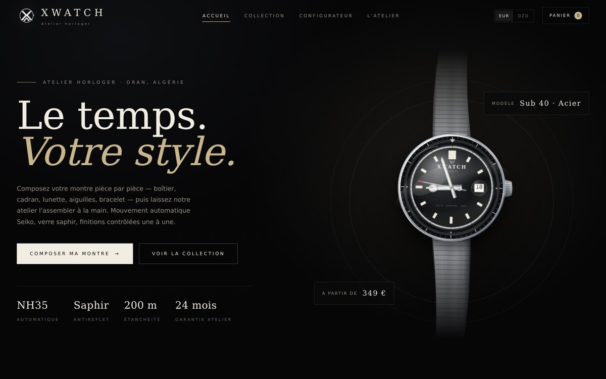
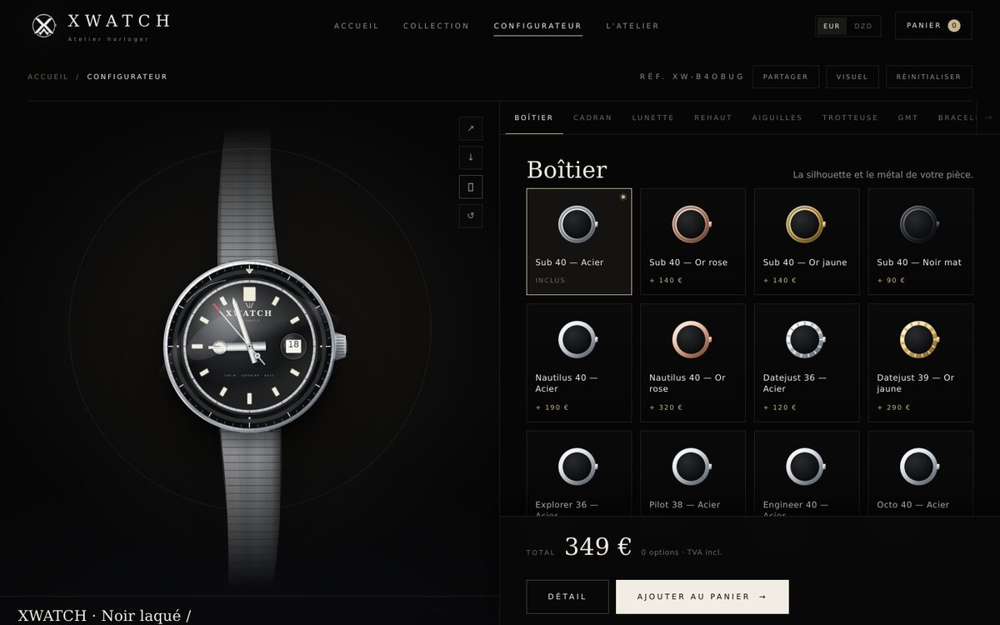
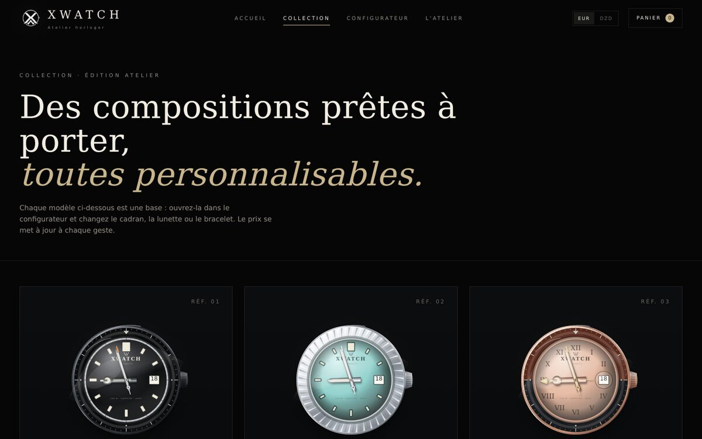

# XWATCH — Le temps. Votre style.

Boutique et configurateur de montres personnalisées (React + Vite + TypeScript).
Interface entièrement en français, direction artistique noir & ivoire, sans dépendance à un backend.

> Ce projet est une création originale inspirée du **parcours d'achat** d'un configurateur de montres
> (choix boîtier → cadran → lunette → aiguilles → bracelet → panier). Le code, les textes, les visuels
> et la marque XWATCH sont propres à ce dépôt : aucun élément du site d'origine n'est copié.



---

## 1. Lancer le site

```bash
cd xwatch
npm install
npm run dev        # http://localhost:5173
```

Build de production :

```bash
npm run build      # génère dist/
npm run preview    # prévisualise le build
```

Le site est une application **100 % statique** (routing par ancre `#`), déployable sur Netlify,
Vercel, Cloudflare Pages, GitHub Pages ou n'importe quel hébergement de fichiers.

---

## 2. Ce que contient le site

| Aperçu | |
|---|---|
|  |  |


| Page | Contenu |
|---|---|
| `#/` | Accueil : hero avec montre animée en temps réel, méthode, modèles signature, matières, avis, FAQ, CTA |
| `#/collection` | 6 compositions prêtes à personnaliser |
| `#/configurateur` | Le configurateur : aperçu SVG en direct, 12 catégories, prix temps réel, gravure, import de logo, partage, export PNG, panier |
| `#/atelier` | Histoire, engagements, chiffres, contact, rendez-vous |

Fonctions clés :

- **Montre vectorielle générée en direct** — 12 boîtiers, 13 cadrans, 10 lunettes, 4 rehauts,
  7 aiguilles, 5 trotteuses, 4 options GMT, 9 bracelets, 2 fonds. Chaque choix modifie l'aperçu et le prix.
- **Prix en EUR ou DZD** (conversion configurable), total recalculé à chaque option.
- **Signature de cadran** : texte + couleur, ou import d'un logo PNG/JPG/WEBP/SVG (2 Mo max).
- **Gravure** : fond, couronne, fermoir, rotor, avec texte libre.
- **Panier persistant** (`localStorage`), fiche récapitulative, commande envoyée par **WhatsApp** ou e-mail.
- **Partage de composition** : un lien encode toute la configuration dans l'URL.
- **Export visuel** : téléchargement de votre montre en PNG haute définition.
- **Responsive** mobile/tablette, animations respectant `prefers-reduced-motion`.

---

## 3. Personnaliser la marque

Un seul fichier à ouvrir : **`src/lib/brand.ts`**

```ts
export const BRAND = {
  name: "XWATCH",
  tagline: "Le temps. Votre style.",
  city: "Oran",
  email: "contact@xwatch.dz",      // ← votre e-mail
  whatsapp: "213555123456",        // ← votre numéro, format international sans « + »
  instagram: "https://instagram.com/xwatch",
  ...
};
```

À remplacer avant la mise en ligne : `email`, `whatsapp`, `instagram`.
Le numéro WhatsApp est le destinataire des commandes (bouton « Envoyer par WhatsApp »).

### Logo et images

- `xwatch/public/assets/monogram.png` → monogramme détouré du logo XWATCH (en-tête, footer, CTA, favicon).
- `xwatch/public/assets/logo-900.jpg` → visuel carré complet, utilisé pour le partage réseaux sociaux (Open Graph).

Les fichiers sont déjà en place : le site fonctionne sans aucune autre image.

Pour changer le logo du site, remplacez `public/assets/monogram.png`.
Pour changer la signature affichée sur les cadrans, modifiez `DialLogo` dans
`src/configurator/Watch.tsx` (texte « XWATCH » + « AUTOMATIC »).

### Numéros, prix, options

- **Prix** : `src/configurator/catalog.ts` — `BASE_PRICE` (349 €) et chaque option (`price`).
- **Taux DZD** : `DZD_RATE` dans `src/lib/store.ts` (285 par défaut).
- **Options** : mêmes fichiers, listes `cases`, `dials`, `bezels`, `rehauts`, `hands`, `seconds`, `gmts`,
  `bracelets`, `casebacks`. Ajouter une entrée suffit : le rendu et le panier suivent automatiquement.

---

## 4. Structure

```
xwatch/
├─ public/assets/            monogramme + visuel de partage
├─ docs/screenshots/         captures du site
├─ src/
│  ├─ configurator/
│  │  ├─ catalog.ts          toutes les options + prix + calculs
│  │  └─ Watch.tsx           rendu SVG de la montre (matières, textures, aiguilles)
│  ├─ components/
│  │  ├─ Header.tsx  Footer.tsx  CartDrawer.tsx  CheckoutModal.tsx
│  │  ├─ Swatch.tsx          vignettes des options
│  │  └─ Reveal.tsx          apparitions au scroll
│  ├─ pages/
│  │  ├─ Home.tsx  Collection.tsx  Configurator.tsx  Atelier.tsx
│  ├─ lib/
│  │  ├─ brand.ts            coordonnées & textes de marque
│  │  ├─ store.ts            panier, devise, localStorage, partage
│  │  ├─ toast.tsx           notifications
│  │  └─ useNow.ts           horloge temps réel
│  ├─ App.tsx                routing par ancre
│  ├─ main.tsx
│  └─ styles.css             design system complet
├─ scripts/
│  ├─ render-watch.tsx       export PNG des variantes (aperçu hors navigateur)
│  └─ smoke.tsx              test de rendu des 4 pages (jsdom)
└─ vite.config.ts
```

---

## 5. Vérifications

```bash
npm run build      # TypeScript + build Vite
npx tsx scripts/smoke.tsx   # rend les 4 pages et vérifie qu'elles ne sont pas vides
npx tsx scripts/render-watch.tsx   # génère .preview/watch-*.png
```

---

## 6. Avant d'ouvrir au public

- [ ] Remplacer le numéro WhatsApp et l'e-mail dans `src/lib/brand.ts`.
- [ ] Ajuster les prix (ou le taux DZD) selon vos coûts réels.
- [ ] Remplacer les témoignages par de vrais avis clients (ne pas inventer d'avis).
- [ ] Ajouter vos conditions de vente, mentions légales et politique de retour.
- [ ] Configurer le paiement : le site ne prélève rien, il prépare une commande WhatsApp/e-mail.
- [ ] Fournir des photos réelles de vos montres si vous en avez (les visuels actuels sont des rendus SVG).
- [ ] Vérifier que la marque « XWATCH » et le logo sont disponibles dans votre pays.

---

## 7. Note sur le site de référence

Le site `watchmodcustom.com` a servi de **référence de parcours utilisateur** (configurateur en
étapes, aperçu à gauche, prix en bas). Il n'a pas été copié : ce dépôt ne contient ni son code, ni ses
images, ni ses textes. Reproduire à l'identique le site d'une autre marque (logo, photos, textes)
exposerait à une action en contrefaçon ; la bonne pratique est de s'inspirer de l'ergonomie et de créer
sa propre identité — c'est ce qui a été fait ici.
